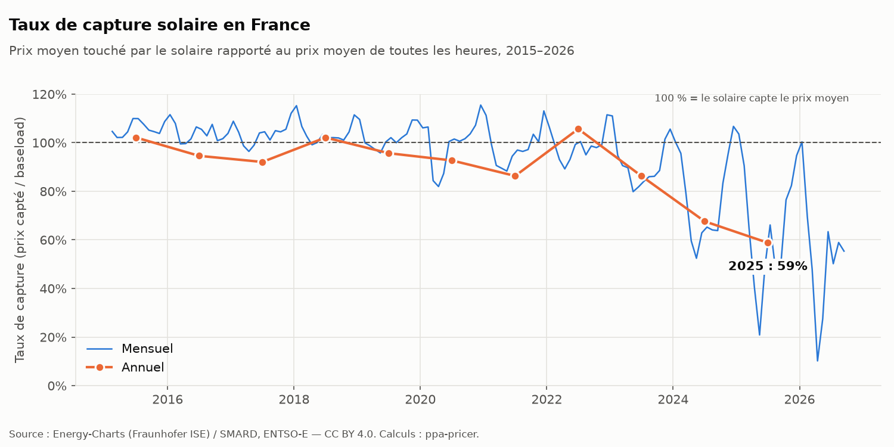
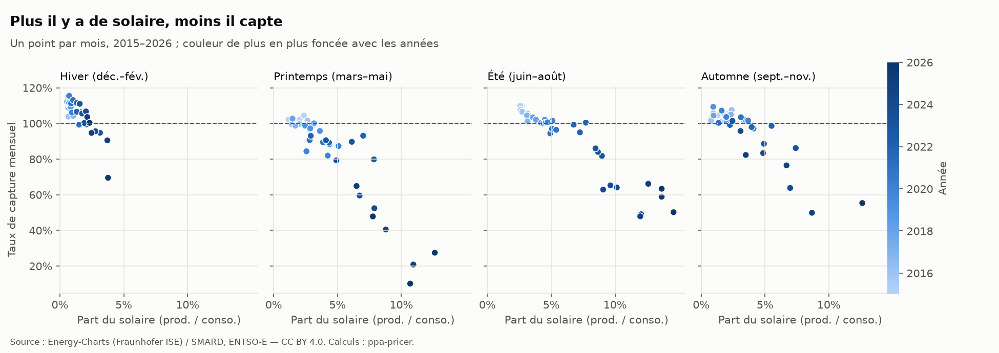

# PPA Pricer : valoriser un contrat d'achat d'électricité solaire en France

*English summary: hourly French power-price models that capture solar cannibalisation, used to
price solar pay-as-produced PPAs (fair price, Monte-Carlo risk, VaR). Every model is backtested
walk-forward against naive baselines, and an audit section states which conclusions hold and
which do not. Docs are in French.*

Projet personnel (ENSTA Paris, mathématiques appliquées). La question est simple : **combien vaut,
en €/MWh, l'électricité d'une centrale solaire vendue à prix fixe pendant un an ?** Le problème
vient de la **cannibalisation** : plus il y a de solaire sur le réseau, plus le prix s'effondre
aux heures où le solaire produit.



Le **taux de capture** est le prix moyen touché par le solaire divisé par le prix moyen de toutes
les heures. Il est passé d'environ 100 % avant 2022 à **59 % en 2025** en France.

## Ce que fait le projet

1. **Données.** Prix day-ahead, production solaire et consommation en France depuis 2015 :
   téléchargement, contrôle des trous, des doublons, du passage au quart d'heure et des
   changements d'heure. Trois sources sont recoupées (Energy-Charts, ENTSO-E, RTE).
2. **Analyse.** Taux de capture mensuel et annuel, heures à prix négatif, profil horaire par
   saison.
3. **Prévision du taux de capture, à un an.** Plusieurs modèles, chacun défini **avant** d'être
   lancé, avec ses attentes écrites :
   - **V1** : régression du taux de capture sur la part du solaire ;
   - **M0, M1, M2** : modèles stochastiques horaires (saisonnalité, retour à la moyenne, prix
     négatifs) conditionnés à la production solaire ;
   - **V2** : niveau de prix ancré sur la courbe à terme, taux de capture relié à la part du
     solaire et au niveau de prix.
4. **Backtest walk-forward** sur 96 mois (2018–2025), contre deux références naïves : la
   persistance (R1) et la climatologie (R2). Score de skill, test de Diebold-Mariano, sensibilité
   aux graines et aux années retirées.
5. **Pricing.** Prix juste d'un PPA pay-as-produced, d'un ruban et d'un PPA avec prix plancher ;
   Monte-Carlo de 1 000 trajectoires, VaR et CVaR à 95 %, décomposition du risque (prix, profil,
   volume).
6. **Audit.** Reproduction depuis un clone neuf, recalcul indépendant, recherche de fuites de
   données, robustesse de chaque conclusion.



## Résultats

| Question | Réponse | Niveau de confiance |
|---|---|---|
| Le modèle V1 bat-il les références naïves ? | Oui, skill de +0,10 contre la persistance et +0,47 contre la climatologie | **Fragile** contre la persistance : gain non significatif (Diebold-Mariano, p ≈ 0,45) |
| Les modèles horaires M1 et M2 font-ils mieux que V1 ? | Non. M2 égale V1, M1 fait moins bien que la persistance | Solide : même verdict sur 10 graines |
| Pourquoi le taux de capture s'est-il effondré en 2024 ? | **Non établi.** Aucune des variantes testées (nucléaire, hydraulique, pays voisins) n'explique la chute | Solide, avec une portée limitée |
| Prix juste 2027, pay-as-produced, Montpellier | **70,6 €/MWh** (67 à 75 selon le rythme de croissance du parc solaire), soit 58 % du baseload | Dépend fortement de la cotation à terme, qui bouge vite |

Le premier prix calculé, 32 €/MWh, s'est révélé **faux** lors de l'audit. Le calcul était juste,
mais il reposait sur un baseload historique de 61 €/MWh, deux fois plus bas que la cotation 2027.
C'est ce qui a conduit à la V2. Les erreurs trouvées sont conservées dans la documentation, avec
leur date et leur correction.

## Limites principales

- **Horizon d'un an seulement.** Un PPA dure 10 à 20 ans, mais il n'existe qu'une dizaine
  d'années de données : un backtest honnête n'est possible qu'à un an.
- **Valeur spot, pas prix de contrat.** Les garanties d'origine, l'équilibrage, le risque de
  crédit et la marge ne sont pas pris en compte.
- **La forme de V2 a été choisie après avoir vu les années de test.** Son backtest ne la valide
  donc pas. Seuls les mois publiés après le 29/10/2026 forment un test propre.
- **VaR sous-estimée.** Le contrôle walk-forward montre que le baseload sort de son intervalle
  4 années sur 10.
- **Prix plancher fragile.** Le modèle produit trop d'heures à prix négatif, et trop profondes.

Le détail est dans [`docs/audit.md`](docs/audit.md), avec le classement de chaque conclusion en
solide, fragile ou faux.

## Pour aller plus loin

| Document | Contenu |
|---|---|
| [`docs/cours/cours_ppa.pdf`](docs/cours/cours_ppa.pdf) | Cours complet : formules, Monte-Carlo, V2, 13 exercices corrigés |
| [`docs/perimetre.md`](docs/perimetre.md) | Définitions et protocole de backtest, fixés avant les résultats |
| [`docs/stochastique.md`](docs/stochastique.md) | Modèles horaires M0, M1, M2 et test de la chute de 2024 |
| [`docs/pricing.md`](docs/pricing.md) | Pricing V1, Monte-Carlo, V2 |
| [`docs/audit.md`](docs/audit.md) | Audit : ce qui tient, ce qui ne tient pas |
| [`docs/hypotheses.md`](docs/hypotheses.md) | Chaque hypothèse chiffrée, avec sa source |
| [`reports/`](reports/) | Rapports générés : backtests, pricing, contrôles de données |

## Installation

```bash
python -m venv .venv && source .venv/bin/activate
pip install -e ".[dev]"
pytest                     # 235 tests, sans les données
```

**Ce dépôt ne contient pas les données**, car certaines licences n'autorisent pas leur
redistribution. Les scripts les retéléchargent depuis les sources publiques : voir
[`data/README.md`](data/README.md).

## Structure

```
src/ppa_pricer/
  donnees/     Téléchargement (Energy-Charts, ENTSO-E, RTE, PVGIS), contrôles, base SQLite
  analyse/     Taux de capture, graphiques
  modele/      V1, M0, M1, M2, V2
  backtest/    Walk-forward, métriques, références naïves, robustesse
  pricing/     Courbe à terme, Monte-Carlo, prix justes et risques
scripts/       Un script par étape ; chacun écrit son rapport dans reports/
tests/         Tests pytest de chaque calcul financier
docs/          Méthode, décisions datées, audit, cours
```

## Droits

Code et documentation : tous droits réservés, aucune licence n'est accordée. Ce dépôt est public
à titre de démonstration ; pour toute réutilisation, contactez-moi.

Sources des données : Energy-Charts (Fraunhofer ISE), SMARD.de / Bundesnetzagentur (CC BY 4.0),
ENTSO-E Transparency Platform, RTE éCO2mix, PVGIS © European Communities 2001–2026.

*Projet d'apprentissage : ce n'est pas un conseil en investissement ni une offre de prix.*
